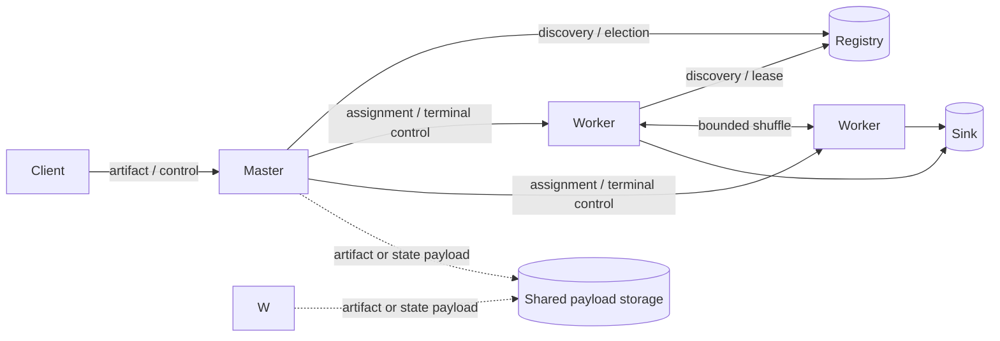

# Cluster topology and scheduling

RowWeave separates the control plane from the execution plane. A Client submits
one complete artifact; an elected Master admits and schedules it; Workers run
stage instances, exchange records, write sinks, and return control results. The
[run modes](../guides/run-modes.md) page is the selection guide. This page
explains the topology, placement, assignment, and lifecycle invariants behind
that guide.

## Roles and process boundaries

A **Client** validates and encodes the job, sends it to the current leader, and
waits for a bounded control result. It never receives rows and never drains a
remote result collection. A **Master** owns job admission, graph compilation,
slot accounting, stage waves, terminal status, and recovery fencing. A
**Worker** owns local slot admission, assignment idempotence, task execution,
shuffle endpoints, and direct sink writes.

The optional **registry** decouples discovery from any one process. The built-in
in-process registry is sufficient for single-Master and embedded deployments.
ZooKeeper, supplied by `rowweave-registry-zk`, provides ephemeral Worker
membership and Master election for cross-host deployments. The core runtime
depends on the registry interface and provider SPI, not on a concrete registry.

## Startup, discovery, and readiness

`ClusterMain` is the Batch process entry point. It first freezes the process
configuration and certified JVM envelope, loads the deployment and transport
context, and only then creates the artifact repository, registry, Master, or
Worker. Every successfully created resource is registered with a reverse-order
cleanup stack, so a failed start or shutdown closes resources exactly once.

A non-registry Master starts fixed leadership services. A registry-enabled
Master joins an exclusive election before exposing leadership. Worker
registration and leadership lookup use independent registry sessions in
ZooKeeper mode, so a Worker always follows the current leader instead of a local
process that may be a standby. A Master prints `MASTER_PORT`; a Worker prints
`WORKER_READY`; readiness automation consumes those standard-output lines rather
than sleeping.

`StreamClusterMain` is the Stream process entry point and supports Master-only,
Worker-only, or explicitly combined processes. It validates the finite resource
envelope, transport identity, deployment set, and registry/artifact combination
before opening a listener or loading providers. Embedded Stream entry points use
the same node-local task factory and lifecycle without requiring an external
listener.

Source authorities:
[`ClusterMain`](../../../rowweave-core/src/main/java/io/rowweave/cluster/ClusterMain.java),
[`StreamClusterMain`](../../../rowweave-core/src/main/java/io/rowweave/StreamClusterMain.java),
[`ServiceRegistry`](../../../rowweave-core/src/main/java/io/rowweave/cluster/registry/ServiceRegistry.java),
and
[`ControlSecurityConfig`](../../../rowweave-core/src/main/java/io/rowweave/cluster/rpc/ControlSecurityConfig.java).
Tested by `ClusterMainWorkerLocatorTest#zkCombinedWorkerLocatesRemoteLeaderNotLocal`,
`ClusterMainWorkerLocatorTest#fixedMasterStartsRetentionButZkMasterWaitsForElection`,
and `StreamClusterConfigTest#zkMasterRequiresSharedArtifactDirectory`.

## Artifact admission and deployment identity

The Client sends the complete portable plan artifact under a stable publication
identity. Before submission it binds the artifact to the verified deployment
set, checks destinations, output commits, plan capability, and bounded resident
memory, and encodes the artifact with a bounded frame budget. The Master repeats
authority checks before admitting the run. A large artifact is payload storage;
registry metadata does not become a substitute for artifact durability.

Durable and registry-backed Batch submissions require an explicitly configured
shared artifact directory. The Master repository applies publication guards,
fenced garbage collection, retention, and bounded maintenance. A deployment
binding changes artifact identity, so an artifact intended for a different
deployment set cannot be silently reused.

Source authorities:
[`ClusterJobClient`](../../../rowweave-core/src/main/java/io/rowweave/cluster/ClusterJobClient.java)
and
[`MasterServer`](../../../rowweave-core/src/main/java/io/rowweave/cluster/MasterServer.java).
Tested by `DeploymentArtifactBindingTest#bindingAddsCanonicalRequiredFeatureAndChangesArtifactIdentity`
and `SlotLedgerTest#acquireWithinCapacityThenReject`.

## Compilation, capacity, and placement

The Master compiles one submitted graph into a topologically ordered execution
graph. Unary pass-through chains are fused; breakers, binary inputs, fan-outs,
keyed exchanges, and sink boundaries remain stage boundaries. The physical plan
expands each logical stage into instances: a keyed stage uses the job
parallelism, a finite source stage uses a source-split-bounded count, a stateless
unary chain may inherit its upstream count, and each Batch sink has one terminal
instance. If no shuffle edge exists, the whole graph is a single-Worker
placement.

Placement assigns instances across the registered Worker snapshot in topology
order. It is deterministic for that snapshot and resource state; it is not a
data-locality optimizer. Slot demand is the sum of instances placed on each
Worker. The Master slot ledger atomically admits the whole job, waits up to the
configured grace, and, when enabled, chooses the highest feasible parallelism
during pressure. A Worker ledger independently enforces its configured slots,
resident bytes, and assignment-thread ceiling. These are admission controls, not
runtime rebalancing.

Source authorities:
[`ExecutionGraphBuilder`](../../../rowweave-core/src/main/java/io/rowweave/cluster/ExecutionGraphBuilder.java),
[`PhysicalPlan`](../../../rowweave-core/src/main/java/io/rowweave/cluster/PhysicalPlan.java),
and
[`StageAssignment`](../../../rowweave-core/src/main/java/io/rowweave/cluster/StageAssignment.java).
Tested by `SlotLedgerTest#demandExceedsCapacityFailsFast`,
`SlotLedgerTest#bestFitPicksHighestFeasibleCandidate`,
`SlotLedgerTest#concurrentAcquireNoOversell`, and
`RealProcessClusterTest#groupBySumRealThreeProcessCluster`.

## Assignment and Worker task lifecycle

Stage assignments are delivered in dependency waves. A durable assignment
carries the exact Worker identity and incarnation, leader endpoint and term,
run-attempt fence, stage command digest, and bounded command payload. Repeated
delivery is idempotent; a conflicting reuse is rejected. The Worker admits the
assignment into a bounded ledger, prepares authorization and resources, starts
one task, and claims ownership of exactly one terminal report. Critical reports
retry until acknowledged or until the assignment fence makes them obsolete.

Cancellation is authoritative at the Master and reflected by an exact stage
fence on the Worker. It rolls back unregistered prepared output, stops dependent
child stages, and waits for a bounded drain before reclaiming slots. A heartbeat
reconciles observed free slots, but the ledger—not the delayed heartbeat—remains
the admission authority. Worker loss releases its slots, quarantines the stale
incarnation, and invokes the mode-specific recovery path rather than partially
reusing old channels.

Source authorities:
[`WorkerServer`](../../../rowweave-core/src/main/java/io/rowweave/cluster/WorkerServer.java),
[`WorkerAssignmentLedger`](../../../rowweave-core/src/main/java/io/rowweave/cluster/WorkerAssignmentLedger.java),
and
[`MasterServer`](../../../rowweave-core/src/main/java/io/rowweave/cluster/MasterServer.java).
Tested by `ClusterCancelStageTest#duplicateAssignIsIdempotentAndConflictingAssignFails`,
`ClusterCancelStageTest#jobFailureMasterCancelsAndReclaims`,
`WorkerIncarnationFenceTest#wrongIncarnationAssignAndCancelHaveNoLedgerSideEffects`,
and `MasterLeadershipFencingTest#registryWorkerFencesPreparedOutputControlsByLeaderTerm`.

## Transport and security boundaries

Control RPC performs an explicit hello before use. Peers intersect manifest,
protocol, reader/writer, message, artifact, stage-command, data-protocol,
deployment, capability, and required-extension sets; any required mismatch fails
before application work. Frames have deadlines and byte bounds, and the control
plane has bounded connection and resident-memory admission.

Cross-host processes use mutual TLS with a closed set of roles. The loopback
profile is limited to one host and cannot advertise a non-loopback target.
Deployment-set identity, SAN, certificate role, Worker incarnation, and leader
term are checked before state mutation. There is no independent shuffle security
profile: the data plane derives its production identity from the verified
control/deployment context.

Batch record exchange uses a multiplexed bounded data plane by default, with
connection, ingress-handler, frame, resident-memory, and timeout limits. Stream
uses the same bounded role-authenticated process boundary and adds separate
command, record, checkpoint, and rescale payload lanes with their own checksums,
sequence, and fencing rules.

Source authorities:
[`ProtocolNegotiator`](../../../rowweave-core/src/main/java/io/rowweave/cluster/rpc/ProtocolNegotiator.java),
[`ControlSecurityConfig`](../../../rowweave-core/src/main/java/io/rowweave/cluster/rpc/ControlSecurityConfig.java),
and
[`WorkerServer`](../../../rowweave-core/src/main/java/io/rowweave/cluster/WorkerServer.java).
Tested by `ProtocolHelloV1Test#negotiationComputesOnlyTheSafeIntersection`,
`ProtocolHelloV1Test#requiredMismatchAndRevisionDriftFailBeforeUse`,
`ControlSecurityConfigTest#mtlsProfileRequiresCompleteMaterialDuringConfigLoad`,
`RpcMtlsAuthorizationTest#productionMtlsDataPortRejectsPlainFrameBeforeDemuxResourcesExist`,
and `StreamRemoteWorkerWireTest#taskProgressUsesChecksummedBoundedV3AndCannotMasqueradeAsV2`.

## Local pseudo-deployment

Batch local mode embeds one bounded job in the application JVM. The InProcess
cluster creates the same Master and Worker product roles in one JVM, uses
in-process control transport, and uses bounded local channels for record flow.
It preserves canonical artifact and assignment encodings, slot admission, fences,
sink boundaries, and typed failures while avoiding sockets.

Stream local mode assembles the same portable DAG, task factory, input gates,
output router, and state/time/checkpoint lifecycle in one JVM. It is a
single-process deployment of the product roles, not a semantic interpreter. Mode
parity applies to accepted behavior and result contracts; timing, transport
certification, failure injection, and cross-host recovery still require the
target deployment mode.

Source authority:
[`InProcessCluster`](../../../rowweave-core/src/main/java/io/rowweave/cluster/InProcessCluster.java).
Tested by `StreamRealProcessClusterTest#independentSourceAndSinkWorkerJvmsExchangeOnlyOverTcp`
and `ClusterConcurrentJobsTest#concurrentJobsOnClusterAvailabilityAndThroughput`.

## Failure isolation and shutdown

A stage failure fails the owning run and cancels its unfinished stages; it does
not leave another job's assignment or output authority active. A Worker failure
is isolated by incarnation, assignment fence, slot release, and quarantine. A
Master leadership change fences old-term writes and old endpoints before a new
term mutates state. A failed role closes resources in reverse construction order
and does not open replacement resources until admission and identity checks pass.

Batch and Stream recovery differ at the durable-state boundary. Batch attempts
use the Master run authority, fenced assignments, output-commit gates, and
artifact publication state. Stream restores only a completed checkpoint or
savepoint through its durable operation authority; recovery and rescale are
whole-graph cutover operations. Operations procedures live in the
[deployment](../operations/deployment.md) and
[Stream runbook](../../runbooks/stream-runtime.md) pages.

Source authorities:
[`MasterServer`](../../../rowweave-core/src/main/java/io/rowweave/cluster/MasterServer.java)
and
[`WorkerServer`](../../../rowweave-core/src/main/java/io/rowweave/cluster/WorkerServer.java).
Tested by `ClusterFailFastTest#leftSourceThrowsFailsFastNoHang`,
`MasterLeadershipFencingTest#leaderTermLossRollsBackPreparedOutputs`, and
`WorkerIncarnationFenceTest#currentGenerationRequiresExactAttemptFenceBeforeMutation`.
