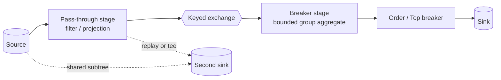

# Pure push execution model

RowWeave executes a Batch job as one admitted DAG. A source pushes rows toward
operators, operators push accepted rows onward, and a sink is the final stage
of that execution graph. The caller never drains a result collection. The
[capability matrix](../reference/capability-matrix.md) states the supported
surface; [Batch behavior](../reference/batch-behavior.md) states operator
semantics. This page explains the execution invariants behind those contracts.

## End-to-end supported shape

A representative finite plan reads rows, applies pass-through projection and
filter logic, exchanges rows by a key, computes a bounded aggregate, orders the
aggregate result, and writes one sink. A job can contain multiple sources,
shared subtrees, multiple sinks, and repeated breakers; these are still one
submitted graph rather than one program per sink.

The diagram is an execution model, not an operator tree. A physical plan may
combine adjacent unary nodes into one stage, add a keyed exchange, materialize
a shared fork, or replay a bounded buffer where a binary operator re-joins
branches.

## Whole-job compilation and stages

`BatchSession` submits one whole-job graph with all sources, operators,
and sinks. The push executor converts that graph into physical stages and wires
adjacent stages through bounded channels. Linear chains become stages. A binary
operator becomes a node with left and right input trees. The executor flattens
the complete tree once and starts all stage tasks together, so a deeply nested
join or union does not become sequential subtree submissions.

Every stage body has one internal contract: read from its input stream, push
accepted rows to its output sink, and return only after its work is complete.
Pass-through operators transform and forward row by row. A breaker drains all
of its upstream before emitting. A binary breaker drains both inputs before
emitting. There is no stage signature that returns a materialized result list.

Source authorities:
[`PushDagExecutor`](../../../rowweave-core/src/main/java/io/rowweave/plan/PushDagExecutor.java)
and
[`PipelineExecutor`](../../../rowweave-core/src/main/java/io/rowweave/sched/PipelineExecutor.java).
Tested by `ClusterPushTest#executeToOutput`,
`ClusterPushTest#e2eCrossStageGroupBy`,
`ClusterPushTest#ironRuleNoListRowDataCarrier`, and
`ComplexDagQuadrantTest#dag01_filterSelectGroupOrderTop`.

## Backpressure and failure propagation

Adjacent local stages communicate through bounded channels with a capacity of
256 records. When a downstream channel is full, its producer blocks until the
consumer releases space. Pressure therefore propagates upstream instead of
accumulating rows in the producer.

End of stream is a sentinel retained at the channel head. A failure poisons the
channel, discards queued records, inserts the first failure, wakes blocked
producers and consumers, and lets the executor fail fast without a cycle of
blocked stages.

The same model uses bounded exchange capacity for keyed local shuffle. Cluster
socket transfer adds credit, frame admission, and connection-level failure
semantics described by
[data-plane limits](../reference/data-plane-limits.md); those controls do not
replace local channel backpressure.

Source authorities:
[`LocalChannel`](../../../rowweave-core/src/main/java/io/rowweave/sched/LocalChannel.java)
and
[`ChannelPoisonedException`](../../../rowweave-core/src/main/java/io/rowweave/sched/ChannelPoisonedException.java).
Tested by `ClusterPushTest#failFastNoDeadlock`,
`BlockingForkGraphTest`, and `MuxConnectionPoolFanoutTest`.

## Shared subtrees and materialization boundaries

Pass-through execution does not collect intermediate rows. The only permitted
materializations are bounded, declared working sets:

| Boundary | Why materialization is needed | Containment |
|---|---|---|
| Sort, aggregate, distinct, TopN, and reduce breaker | The operator cannot produce its first final row until it has consumed its full logical input. | Explicit managed-memory budget; overflow spills bounded runs and merges them. |
| Binary join or co-group input | Each side may need keyed ordering or lookup state before matching. | Keyed working set, memory budget, and spill path. |
| Shared fork feeding re-joining branches | A diamond or self-join needs the same finite upstream available to each branch. | A materialization plan selects the fork; the shared fork is computed once and replayed from a bounded, spill-backed buffer. |
| Map partition input | The user function consumes one physical partition as a finite sequence. | Partition identity and emission limits are explicit. |

A tee from one shared prefix to independent downstream branches is executed as
one shared computation, not once per branch. A diamond that re-joins two reads
of the same source uses the selected materialized fork rather than leaving live
branches blocked on each other. `FanoutMultiOutputEquivalenceTest#fiveOutputFanoutCorrectAndComputedOnce`
and the blocking-fork tests pin both the compute-once result and the deadlock
boundary.

Source authorities:
[`BlockingFanout`](../../../rowweave-core/src/main/java/io/rowweave/sched/BlockingFanout.java)
and
[`MaterializationPlan`](../../../rowweave-core/src/main/java/io/rowweave/plan/MaterializationPlan.java).
Tested by `FanoutMultiOutputEquivalenceTest#fiveOutputFanoutCorrectAndComputedOnce`,
`BlockingForkGraphTest`, and `MultiSinkExecutionGraphTest`.

## Deterministic semantics

Default execution preserves the operator contract while allowing parallel
physical placement. Set-valued sink output is equivalent without imposing an
ordering that the plan did not declare. An explicit ordering or TopN operator
is the ordering boundary. Decimal rounding and the null rules for grouping,
ordering, and joining are fixed by [decimal and null
semantics](../reference/decimal-null-semantics.md), and every stage applies them
the same way, so spilling or parallelizing a breaker cannot change a result.

Breaker results compare against stable oracle results under spill and
concurrent multi-breaker execution. Source authority:
[`StageExecutionTelemetry`](../../../rowweave-core/src/main/java/io/rowweave/plan/StageExecutionTelemetry.java).
Tested by `SpillWiringTest#groupBySpillMatchesHeap`,
`SpillWiringTest#orderBySpillOrdered`,
`SpillWiringTest#sharedBudgetMultiBreakerPeakBounded`,
`SpillWiringTest#concurrentMultiBreakerSpillDeterministic`, and
`SingleMachineJoinShuffleTest#innerJoinParallelBitIdenticalToOracle`.

## Cancellation and bounded shutdown

Cancellation is coordinated at stage boundaries rather than left to an
uncooperative loop. A stage can release active blocking resources on cancel; a
terminal sink closes only after the terminal gate accepts, otherwise it aborts
the output. The executor joins stages and propagates the first failure. A
non-cooperative running stage receives a bounded cancellation failure, and a
negative drain window is refused before opening a Worker.

Source authorities:
[`PushDagExecutor`](../../../rowweave-core/src/main/java/io/rowweave/plan/PushDagExecutor.java)
and
[`PipelineExecutor`](../../../rowweave-core/src/main/java/io/rowweave/sched/PipelineExecutor.java).
Tested by `BoundedStageCancellationTest#uncooperativeRunningStageReturnsBoundedCancellationFailure`
and `BoundedStageCancellationTest#rejectsNegativeCancelDrainBeforeOpeningWorker`.

## Public and internal boundaries

`BatchSession`, `DataSet`, `Source`, `Sink`, function interfaces, and
Stream composition APIs are public. `RowStream`, `RowSink`, `Channel`,
`PipelineExecutor`, and `PushDagExecutor` are internal execution types. User
code extends the engine through public operators, functions, source and sink
providers, deployment contracts, or Stream SPIs—not by injecting rows into an
internal channel. [Run modes](../guides/run-modes.md) describes the supported
embedding boundary.
